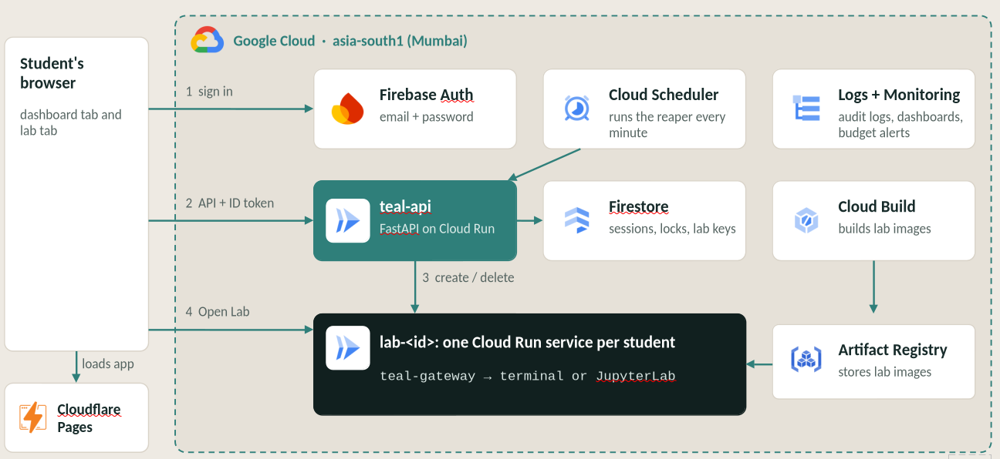

<p align="center">
  
</p>

<h1 align="center">TEAL</h1>

<p align="center">
  A cloud-hosted lab platform built for Amrita University students. Provisions isolated, time-limited lab environments on Google Cloud Run and serves them through a browser, requiring no local installation. Students log in with their Amrita student email, launch a lab, and get a fully interactive terminal, VS Code (openvscode-server), or JupyterLab environment that runs for 60 minutes before being automatically cleaned up.
</p>

---

## Table of Contents

- [Overview](#overview)
- [Architecture](#architecture)
- [Components](#components)
  - [Backend API](#backend-api)
  - [Lab Gateway](#lab-gateway)
  - [Dashboard](#dashboard)
  - [Lab UI](#lab-ui)
  - [Lab Templates](#lab-templates)
  - [Infrastructure](#infrastructure)
- [Lab Catalog](#lab-catalog)
- [Session Lifecycle](#session-lifecycle)
- [Authentication and Access Control](#authentication-and-access-control)
- [Cost Tracking](#cost-tracking)
- [Reaper](#reaper)
- [Local Development](#local-development)
- [Deployment](#deployment)
  - [First-time setup](#first-time-setup)
  - [CI/CD Deployment (GitHub Actions)](#cicd-deployment-github-actions)
  - [Building lab images](#building-lab-images)
  - [Deploying the API manually](#deploying-the-api-manually)
  - [Deploying the dashboard](#deploying-the-dashboard)
- [Environment Variables](#environment-variables)
- [GCP Services Used](#gcp-services-used)
- [Repository Structure](#repository-structure)
- [Team](#team)

---

## Overview

Each lab session is a dedicated Cloud Run service. The backend API creates the service on demand, the gateway sidecar inside the container handles authentication via a one-time token and proxies the terminal, VS Code, or JupyterLab interface, and the dashboard polls for status and provides the access link once the container is ready.

Key properties:

- One lab at a time per user, enforced by a Firestore transaction
- 60-minute hard time limit, enforced by the container itself and by a Cloud Scheduler reaper
- Access is token-gated: the URL includes a fragment token that is exchanged for an HttpOnly session cookie, so the token never appears in server logs
- All Firestore access is server-side only; Firestore rules deny all client reads and writes
- Restricted to `*.students.amrita.edu` email addresses

---

## Architecture



Cloud Scheduler fires `POST /internal/reap` on teal-api every minute to expire and clean up abandoned sessions.

---

## Components

### Backend API

**Location:** `backend/`

A FastAPI application deployed as a Cloud Run service (`teal-api`). It is the single source of truth for session state and the only component that talks to the Cloud Run Admin API and Firestore.

**Modules:**

| File | Purpose |
|---|---|
| `app/main.py` | FastAPI app, routes, CORS, startup, interface selection |
| `app/auth.py` | Firebase ID token verification, email domain check |
| `app/catalog.py` | Loads and validates `catalog.json` with multi-interface validation |
| `app/sessions.py` | Full session lifecycle: launch with interface, ready-check, end |
| `app/provisioner.py` | Cloud Run Admin API v2 wrapper (create, status, delete, list) |
| `app/reaper.py` | Reaper logic and `POST /internal/reap` endpoint |
| `app/history.py` | `GET /api/sessions/history` — last 10 sessions with interface info |
| `app/cost.py` | USD cost calculation from CPU/memory/duration |
| `app/config.py` | Typed settings object; auto-loads `.env` and resolves catalog path |

**API routes:**

| Method | Path | Description |
|---|---|---|
| `GET` | `/api/me` | Authenticated identity check |
| `GET` | `/api/templates` | Public lab catalog with available interface IDs |
| `GET` | `/api/session` | Active session with readiness polling and interface |
| `POST` | `/api/sessions` | Launch a new lab (accepts `template` and optional `interface`) |
| `DELETE` | `/api/session` | End the active lab |
| `GET` | `/api/sessions/history` | Last 10 sessions with interface used |
| `POST` | `/api/labs/{id}/end` | Lab-side end callback (lab token auth) |
| `POST` | `/internal/reap` | Cloud Scheduler reaper (OIDC auth) |

**Firestore collections:**

| Collection | Document key | Purpose |
|---|---|---|
| `sessions/{sessionId}` | Random 10-char ID | Permanent session record (includes `interface`, status, cost) |
| `activeSessions/{uid}` | Firebase UID | One-per-user lock with active `interface`, scanned by reaper |
| `sessionSecrets/{sessionId}` | Session ID | Plaintext + SHA-256 of lab token, deleted on end |

### Lab Gateway

**Location:** `gateway/`

A Python `aiohttp` server embedded as a sidecar in every lab container image. It runs on port 8080 (the Cloud Run ingress port) and gates all access behind cookie authentication.

**Modules:**

| File | Purpose |
|---|---|
| `teal_gateway/server.py` | Main aiohttp app, auth, and route handlers |
| `teal_gateway/proxy.py` | HTTP streaming and WebSocket reverse proxy; strips `X-Frame-Options` |
| `teal_gateway/supervisor.py` | Manages child process (ttyd, openvscode-server, JupyterLab) |
| `teal_gateway/__main__.py` | CLI entrypoint, argument parsing |

**Gateway endpoints:**

| Method | Path | Description |
|---|---|---|
| `GET` | `/__teal/healthz` | Unauthenticated liveness probe; returns 410 when expired |
| `POST` | `/__teal/auth` | Exchange URL fragment token for session cookie |
| `GET` | `/__teal/info` | Lab metadata (name, tools, expiry, dashboard URL) |
| `POST` | `/__teal/end` | Terminate lab — calls teal-api and stops child process |
| `GET` | `/__teal/files` | Browse, download files, or stream home directory as tar.gz |
| `*` | `/terminal/*`, `/vscode/*`, or `/jupyter/*` | Proxied to the upstream interface process |
| `GET` | `/` | Serves lab UI if authenticated, bootstrap page otherwise |

**Authentication flow inside the lab:**

1. The access URL delivered to the dashboard includes a fragment `#t=<plaintext-token>`.
2. The bootstrap page (served to unauthenticated requests) reads the fragment in JavaScript and POSTs the token to `/__teal/auth`.
3. The gateway verifies the token against `TEAL_TOKEN_SHA256` and sets an HttpOnly `teal_lab` session cookie.
4. The page reloads; subsequent requests carry the cookie and are admitted.

### Dashboard

**Location:** `web/`

A React + TypeScript SPA deployed on Cloudflare Pages. Built with Vite, Tailwind CSS v4, shadcn/ui components, and Motion for animations.

**Pages:**

| Route | Component | Description |
|---|---|---|
| `/` | `Landing.tsx` | Public landing page |
| `/login` | `Login.tsx` | Email/password sign-in |
| `/signup` | `Signup.tsx` | Account creation with strong password validation |
| `/forgot` | `ForgotPassword.tsx` | Password reset |
| `/verify` | `CheckInbox.tsx` | Email verification gate |
| `/dashboard` | `Dashboard.tsx` | Lab catalog, active session, history |
| `/404` | `NotFound.tsx` | Not found fallback page |

**Dashboard behaviour:**

- Interactive **Interface Picker**: Allows students to select their preferred interface (e.g. Terminal vs. VS Code) before launching labs that offer multiple options.
- Visual **Interface Badges** (`terminal`, `vscode`, `jupyter`) across catalog cards, active session card, and recent history.
- Polls `GET /api/session` until the lab transitions from `starting` to `running`.
- Shows an active lab card with a live countdown timer and an "Open Lab" button once the access URL is available.
- Displays the last 10 sessions and the cumulative USD spend.
- A `VITE_MOCK=1` mode allows fully offline development with fake auth and a fake API, with query-string overrides for error scenarios (`?mock=launches_disabled`, `?mock=capacity_full`, `?mock=offline`, and others).

### Lab UI

**Location:** `lab-ui/`

A lightweight React + TypeScript SPA bundled into every lab container image. It is served by the gateway at `/` after authentication and wraps the interface in a full-screen iframe:
- `/terminal/` for ttyd
- `/vscode/?folder=/home/student/work` for openvscode-server
- `/jupyter/lab` for JupyterLab

Features:

- Top bar showing the lab name, tool list, and a live countdown timer
- Warning toasts at 10 minutes and 2 minutes remaining
- "End Lab" button with a confirmation modal
- Right-side panel with lab details and a file browser backed by `/__teal/files` (automatically hidden in VS Code mode where the editor provides its own native file explorer)
- **Mobile Responsive Design**: Fully optimized for mobile screens and phones with a collapsible sidebar drawer (`useSidebar`), responsive top bar, and adaptive controls
- Session-ended overlay on expiry, manual end, or health-check failure
- Health polling every 15 seconds against `/__teal/healthz`

### Lab Templates

**Location:** `templates/`

Each lab is defined by a directory containing a `Dockerfile` and an entry in `templates/catalog.json`.

**Available labs:**

| ID | Name | Interfaces | CPU | Memory | Tools |
|---|---|---|---|---|---|
| `linux` | Linux Lab | `terminal` (`linux-term:v3`),<br>`vscode` (`linux-code:v3`) | 1 vCPU | 1 GiB | bash, gcc / make (build-essential), python3, pip3, vim, nano, git, tmux, curl |
| `pfl` | PFL: Principles of Functional Languages | `terminal` (`pfl:v3`) | 1 vCPU | 2 GiB | GHC 9.x (GHCup), GHCi, cabal, stack, GHCup, vim, nano, git, tmux |
| `nndl` | NNDL - Neural Networks & Deep Learning | `jupyter` (`nndl:v3`) | 2 vCPU | 4 GiB | Python 3.12, JupyterLab, TensorFlow (CPU), Keras, numpy, pandas, matplotlib, scikit-learn |

**Image build pattern:**

All lab images are multi-stage. The `gateway.Dockerfile` produces a scratch image containing the gateway code and the compiled lab-ui bundle. Each lab Dockerfile starts from a base runtime image, installs its tools, then copies `/opt/teal-gateway` from the gateway image and sets the gateway as the entrypoint.

```
templates/gateway.Dockerfile     ->  gateway image (scratch, code + UI only)
templates/linux-term/Dockerfile  ->  linux-term image (bash, build-essential, tmux + ttyd)
templates/linux-code/Dockerfile  ->  linux-code image (openvscode-server web IDE)
templates/pfl/Dockerfile         ->  pfl image (Haskell toolchain + ttyd)
templates/nndl/Dockerfile        ->  nndl image (JupyterLab + TensorFlow CPU)
```

All lab images can be built together in a single Cloud Build execution using `infra/cloudbuild-labs.yaml`.

The base layer (`templates/base/install-base.sh`) creates a `student` user, installs tmux, and applies a shared tmux configuration.

### Infrastructure

**Location:** `infra/`

| File | Purpose |
|---|---|
| `env.sh` | Shell environment for Cloud Shell sessions; sets `PROJECT`, `REGION`, service account names |
| `setup-core.sh` | One-time GCP setup: APIs, service accounts, custom IAM role, IAM bindings |
| `setup-wif.sh` | One-time Workload Identity Federation setup for GitHub Actions CI/CD |
| `cloudbuild.yaml` | Cloud Build config; builds one image per invocation via `--substitutions` |
| `cloudbuild-labs.yaml` | Unified Cloud Build pipeline; builds gateway and all lab images in one shot |
| `api.env.yaml` | Non-secret environment variables for the `teal-api` Cloud Run deployment |
| `firestore.rules` | Firestore security rules (deny all client access) |
| `firestore.indexes.json` | Composite index on `sessions`: `uid ASC`, `createdAt DESC` |

Service accounts:

| Service account | Roles | Purpose |
|---|---|---|
| `teal-api` | `tealProvisioner` (custom), `datastore.user`, `logging.logWriter` | Backend API identity |
| `teal-lab-runtime` | None | Lab container identity (no GCP access by design) |
| `teal-scheduler` | — | Calls `/internal/reap` via Cloud Scheduler OIDC |
| `teal-cicd` | `run.admin`, `artifactregistry.writer`, `cloudbuild.builds.editor`, `iam.serviceAccountUser`, `storage.objectViewer`, `logging.logWriter` | GitHub Actions CI/CD via Workload Identity Federation |

---

## Lab Catalog

The catalog is a JSON file at `templates/catalog.json`, mounted into the API container at `/app/catalog.json`. It is loaded once at startup. Required fields per entry: `id`, `name`, `description`, `interfaces`, `tools`, `cpu`, `memory`, `durationMinutes`. `interfaces` is a non-empty ordered list of `{ "id": "terminal" | "jupyter" | "vscode", "image": "<name>:<tag>" }` objects; the first one is the default, and a lab can offer several (for example Linux Lab via `linux-term` or `linux-code`). The public `/api/templates` response lists only the interface IDs, never image names, and `POST /api/sessions` accepts an optional `interface` (default: the first). The backend attaches an `approxCostUsd` field derived from the resource configuration before returning the catalog to the dashboard.

To add a lab: create a directory under `templates/` per interface image, add a `Dockerfile` to each, add an entry to `catalog.json`, build and push the images, then redeploy the API.

---

## Session Lifecycle

```
User clicks Launch
       |
       v
POST /api/sessions
       |
       |-- Firestore transaction: write activeSessions/{uid} + sessions/{id} + sessionSecrets/{id}
       |-- Cloud Run create_service (fire-and-forget)
       |
       v
status: starting
       |
       v  (GET /api/session polls every few seconds)
       |
       |-- provisioner.status(service_name) -> (ready, url)
       |-- On ready: update status to "running", build accessUrl
       |
       v
status: running  ->  dashboard shows "Open Lab" button
       |
       |-- User clicks "Open Lab"
       |-- Bootstrap page exchanges fragment token for cookie
       |-- Lab UI loads in full screen
       |
       |-- User clicks "End Lab"  or  timer expires  or  reaper fires
       |
       v
POST /api/labs/{id}/end  (from gateway)  or  DELETE /api/session  (from dashboard)
       |
       |-- status: ending
       |-- provisioner.delete(service_name)
       |-- Batch write: status=ended, endReason, endedAt, costUsd
       |-- Delete activeSessions/{uid} and sessionSecrets/{id}
       |
       v
status: ended
```

---

## Authentication and Access Control

**Dashboard:**

- Firebase Authentication (email/password)
- Only `*.students.amrita.edu` addresses are accepted (enforced by `ALLOWED_EMAIL_REGEX` on the backend)
- Email must be verified before the dashboard is accessible
- Every API request carries a Firebase ID token as a Bearer token; the backend verifies it with the Firebase Admin SDK

**Lab container:**

- The access URL contains a plaintext token in the URL fragment (`#t=<token>`)
- The bootstrap page POSTs the token to `/__teal/auth`; the gateway checks it against the SHA-256 hash stored in `TEAL_TOKEN_SHA256` using constant-time comparison
- On success an HttpOnly, SameSite=Lax session cookie is set
- All gateway routes except `/__teal/healthz` and `/__teal/auth` require the cookie

---

## Cost Tracking

Cost is calculated as:

```
cost = seconds * (vCPU * PRICE_VCPU_SEC + GiB * PRICE_GIB_SEC)
```

Default rates are `$0.000018 / vCPU-second` and `$0.000002 / GiB-second`, matching Cloud Run instance-based billing in `asia-south1`. These are configurable via environment variables. The cost is computed when a session ends and stored in `sessions/{id}.costUsd`. The dashboard shows the total cumulative spend across the last 10 sessions.

---

## Reaper

Cloud Scheduler triggers `POST /internal/reap` on the API every minute. The endpoint is authenticated by verifying a Google OIDC token issued to the `teal-scheduler` service account.

Each reaper pass:

1. Lists all `activeSessions` documents from Firestore
2. Lists all Cloud Run services labelled `teal-lab=true`
3. For each active session:
   - If `starting` and not yet ready: runs a readiness check; marks `failed` if stuck for more than 5 minutes
   - If past `expiresAt`: ends the session with reason `expired`
   - If `ending` (a previous end did not complete): retries the end
   - If `running` and its Cloud Run service is missing: ends with reason `deleted`
4. Deletes any orphaned Cloud Run lab services (labelled `teal-lab=true` but with no matching active session) older than 2 minutes

---

## Local Development

### Dashboard

```bash
cd web
cp .env.example .env.local
# Edit .env.local — set VITE_MOCK=1 for offline mock mode
bun install
bun run dev
```

With `VITE_MOCK=1` no backend or Firebase credentials are needed. Error scenarios can be triggered with `?mock=launches_disabled`, `?mock=capacity_full`, `?mock=offline`, and others.

To connect to a real backend, set `VITE_API_URL`, `VITE_FIREBASE_API_KEY`, and the other Firebase variables in `.env.local` and set `VITE_MOCK=0`.

### Backend API

```bash
cd backend
python -m venv venv && source venv/bin/activate
pip install -r requirements.txt
# Set GCP_PROJECT, LAB_SA, SCHEDULER_SA, IMAGE_REPO, PUBLIC_URL, CATALOG_PATH
# Set GOOGLE_APPLICATION_CREDENTIALS to a service account key file
CATALOG_PATH=../templates/catalog.json uvicorn app.main:app --reload
```

### Lab Gateway (standalone)

```bash
cd gateway
pip install -r requirements.txt
# Without TEAL_TOKEN_SHA256 set, the gateway allows all requests (dev mode)
python -m teal_gateway --upstream=http://127.0.0.1:7681 --prefix=/terminal -- ttyd -p 7681 bash
```

### Lab UI

```bash
cd lab-ui
bun install
bun run dev
```

---

## Deployment

### First-time setup

```bash
# From Cloud Shell, at the repo root
source infra/env.sh
bash infra/setup-core.sh

# To also grant Cloud Build the permissions it needs:
bash infra/setup-core.sh --build-perms

# To set up Workload Identity Federation for GitHub Actions CI/CD:
bash infra/setup-wif.sh
```

This enables required APIs, creates service accounts, creates the `tealProvisioner` custom role, configures Workload Identity Federation, and assigns IAM bindings. It is idempotent and safe to re-run. Add the output `WIF_PROVIDER` and `WIF_SERVICE_ACCOUNT` as repository secrets in GitHub Actions.

### CI/CD Deployment (GitHub Actions)

The repository includes an automated CI/CD pipeline (`.github/workflows/deploy-backend.yml`) for the backend API:

- **Keyless GCP authentication** via Workload Identity Federation (no long-lived service account keys).
- **Triggered on push** to `main` when files under `backend/**`, `templates/catalog.json`, `infra/api.env.yaml`, or the workflow file change.
- Builds Docker image directly on GitHub runner and tags with both commit SHA (`sha-<hash>`) and `:latest`.
- Pushes image to Artifact Registry and deploys to Cloud Run with `--allow-unauthenticated` so FastAPI handles Firebase Auth verification.

### Building lab images

To build the gateway and all lab images (`linux-term`, `linux-code`, `pfl`, `nndl`) in a single Cloud Build invocation:

```bash
source infra/env.sh

# Recommended: build gateway and all lab images together with the same tag
gcloud builds submit --config infra/cloudbuild-labs.yaml --substitutions=_TAG=v3 .
```

To build individual images using `infra/cloudbuild.yaml`:

```bash
# Build the gateway base image first (lab images depend on it)
gcloud builds submit --config infra/cloudbuild.yaml \
  --substitutions=_IMAGE=gateway,_TAG=v3,_DOCKERFILE=templates/gateway.Dockerfile .

# Build an individual lab image
gcloud builds submit --config infra/cloudbuild.yaml \
  --substitutions=_IMAGE=linux-code,_TAG=v3,_DOCKERFILE=templates/linux-code/Dockerfile,_GATEWAY_TAG=v3 .
```

### Deploying the API manually

```bash
# Build the API image (if not using CI/CD)
gcloud builds submit --config infra/cloudbuild.yaml \
  --substitutions=_IMAGE=api,_TAG=v1,_DOCKERFILE=backend/Dockerfile .

# Deploy to Cloud Run
gcloud run deploy teal-api \
  --image=$REPO/api:v1 \
  --region=$REGION \
  --service-account=$API_SA \
  --env-vars-file=infra/api.env.yaml \
  --allow-unauthenticated \
  --ingress=all
```

### Deploying the dashboard

The dashboard is deployed on Cloudflare Pages. Connect the repository and set the following environment variables in the Pages project settings:

```
VITE_API_URL=<teal-api Cloud Run URL>
VITE_FIREBASE_API_KEY=<key>
VITE_FIREBASE_AUTH_DOMAIN=<domain>
VITE_FIREBASE_PROJECT_ID=<project>
VITE_FIREBASE_APP_ID=<app-id>
```

Build command: `bun run build` (run from the `web/` directory)
Output directory: `web/dist`

---

## Environment Variables

### Backend API (`infra/api.env.yaml`)

| Variable | Description |
|---|---|
| `GCP_PROJECT` | GCP project ID |
| `REGION` | Cloud Run region (default: `asia-south1`) |
| `LAB_SA` | Lab container service account email |
| `SCHEDULER_SA` | Cloud Scheduler service account email |
| `IMAGE_REPO` | Artifact Registry repo prefix for lab images |
| `CATALOG_PATH` | Path to `catalog.json` inside the container |
| `PUBLIC_URL` | Public URL of the `teal-api` service |
| `FRONTEND_ORIGIN` | Dashboard origin for CORS |
| `ALLOWED_EMAIL_REGEX` | Regex for allowed email addresses |
| `MAX_CONCURRENT_LABS` | Global cap on simultaneous lab sessions (default: `40`) |
| `LAUNCHES_ENABLED` | Set to `false` to pause all new launches |
| `PRICE_VCPU_SEC` | USD per vCPU-second for cost calculation |
| `PRICE_GIB_SEC` | USD per GiB-second for cost calculation |

### Dashboard (`web/.env.example`)

| Variable | Description |
|---|---|
| `VITE_MOCK` | `1` for offline mock mode, `0` for real backend |
| `VITE_API_URL` | teal-api base URL |
| `VITE_FIREBASE_API_KEY` | Firebase web app API key |
| `VITE_FIREBASE_AUTH_DOMAIN` | Firebase auth domain |
| `VITE_FIREBASE_PROJECT_ID` | Firebase project ID |
| `VITE_FIREBASE_APP_ID` | Firebase app ID |

### Lab containers (injected by teal-api at launch)

| Variable | Description |
|---|---|
| `TEAL_SESSION_ID` | Session ID |
| `TEAL_TOKEN_SHA256` | SHA-256 of the plaintext lab access token |
| `TEAL_EXPIRES_AT` | ISO 8601 expiry timestamp |
| `TEAL_API_URL` | URL of teal-api (for the end callback) |
| `TEAL_DASHBOARD_URL` | Dashboard URL for the "Return to Dashboard" link |
| `TEAL_LAB_INFO` | JSON blob with lab name, tools, and resource config |

---

## GCP Services Used

| Service | Purpose |
|---|---|
| Cloud Run | Hosts the teal-api service and all ephemeral lab containers |
| Firestore | Session state, active session locks, session secrets |
| Firebase Authentication | User identity, email verification |
| Artifact Registry | Stores lab and API container images |
| Cloud Build | Builds container images |
| Cloud Scheduler | Triggers the reaper every minute |
| Cloud Logging | Structured JSON log ingestion |

---

## Repository Structure

```
TEAL/
├── .github/
│   └── workflows/
│       └── deploy-backend.yml GitHub Actions CI/CD for Cloud Run
├── backend/                   FastAPI backend API
│   ├── app/
│   │   ├── main.py            Routes, CORS, interface handling, app setup
│   │   ├── auth.py            Firebase token verification
│   │   ├── catalog.py         Lab catalog loader & multi-interface validation
│   │   ├── sessions.py        Session lifecycle (launch, poll, end)
│   │   ├── provisioner.py     Cloud Run Admin API wrapper
│   │   ├── reaper.py          Reaper logic and endpoint
│   │   ├── history.py         Session history endpoint
│   │   ├── cost.py            USD cost calculation
│   │   └── config.py          Settings from environment (.env auto-load)
│   ├── Dockerfile
│   └── requirements.txt
├── gateway/                   Lab gateway sidecar
│   └── teal_gateway/
│       ├── server.py          aiohttp app, auth, and route handlers
│       ├── proxy.py           HTTP & WebSocket reverse proxy (strips X-Frame-Options)
│       ├── supervisor.py      Child process manager (ttyd, openvscode-server, Jupyter)
│       └── __main__.py        CLI entrypoint
├── web/                       Student-facing dashboard (React)
│   └── src/
│       ├── pages/             Landing, Dashboard, Login, Signup, Forgot, CheckInbox, NotFound
│       ├── components/        CatalogGrid (with InterfacePicker), ActiveLabCard, RecentLabs
│       ├── hooks/             React hooks (useLabSession, useAuth)
│       ├── auth/              Firebase auth context and guards
│       └── lib/               API client, types, mock data
├── lab-ui/                    In-lab UI served by the gateway (React)
│   └── src/
│       ├── App.tsx            Main layout (embeds terminal, vscode, or jupyter iframe)
│       ├── hooks/             useSidebar (responsive mobile drawer state)
│       └── components/        TopBar, RightPanel, EndModal, file browser
├── templates/                 Lab container definitions
│   ├── catalog.json           Lab registry with multi-interface declarations
│   ├── gateway.Dockerfile     Builds the gateway base image (bundles lab-ui)
│   ├── base/                  Shared base layer (student user, tmux)
│   ├── linux-term/            Linux Lab - Terminal interface (ttyd)
│   ├── linux-code/            Linux Lab - VS Code interface (openvscode-server)
│   ├── pfl/                   Functional Languages Lab (Haskell toolchain)
│   └── nndl/                  Neural Networks Lab (JupyterLab + TensorFlow)
├── infra/                     Deployment and infrastructure
│   ├── env.sh                 Shell environment for Cloud Shell
│   ├── setup-core.sh          One-time GCP provisioning script
│   ├── setup-wif.sh           Workload Identity Federation setup for GitHub Actions
│   ├── cloudbuild.yaml        Single image Cloud Build config
│   ├── cloudbuild-labs.yaml   Unified Cloud Build pipeline for all lab images
│   ├── api.env.yaml           API service environment variables
│   ├── firestore.rules        Firestore security rules
│   └── firestore.indexes.json Firestore composite index definition
└── scripts/                   Utility scripts
```

---

## Team

- **Adithya Menon R** — [github.com/adithya-menon-r](https://github.com/adithya-menon-r)
- **Anuj A** — [github.com/a-anuj](https://github.com/a-anuj)
- **Jei Akash** — [github.com/ak-krishnan](https://github.com/ak-krishnan)
